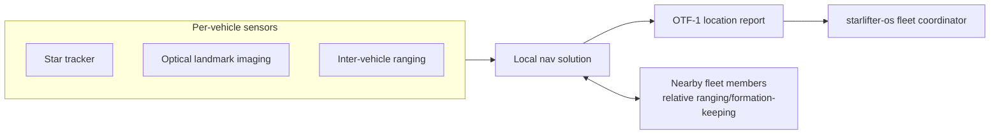

# Navigation Approach — Draft

Not a finalized design -- a starting point for the open questions in the
[README](../README.md).

## Candidate techniques (needs real evaluation, not just listing)

| Technique | Good for | Limitation here |
|---|---|---|
| Star tracker + ephemeris | Absolute attitude, well-proven | Doesn't give position directly, needs pairing with another method |
| Optical landmark navigation | Position near a known body (asteroid, Moon) | Needs a pre-built landmark map; not available for a first arrival at a new target |
| Inter-vehicle ranging (radio/laser) | Relative positioning within the fleet | Needs at least one anchor with known absolute position |
| Earth-based tracking (DSN-style) | Absolute position ground truth | Light-delay makes it unusable for real-time control at belt distances |

## What a first demonstrator probably needs

Likely a minimum viable stack of star-tracker attitude + optical landmark
navigation once approaching a known target, with inter-vehicle ranging
reserved for once there's an actual multi-vehicle fleet to coordinate --
but this is a guess, not a decision. Real trade study needed before
committing.
